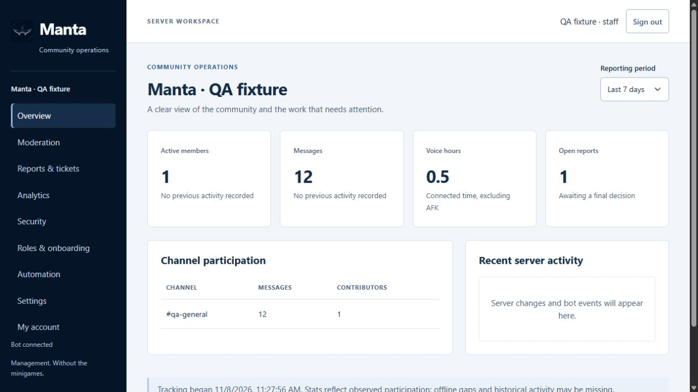

  

<h1 align="center">Manta</h1>

A free, open-source Discord bot for running your community.

  
  

  <a href="https://manta-website-six.vercel.app/">Website</a> ·
  <a href="docs/setup.md">Setup guide</a> ·
  <a href="https://github.com/Fai1th/Manta-Website">Dashboard source</a>

Moderation · Support tickets · Roles · Activity stats · Automation · Integrations

  
   Dashboard preview · Test data

## Cloud configuration

1. **Host:** deploy the [Manta-Website Docker app](https://github.com/Fai1th/Manta-Website) on an always-running service with persistent storage mounted at `/data`.
2. **Discord:** connect your application, enable Server Members Intent and set the OAuth callback to `https://YOUR_DOMAIN/auth/callback`.
3. **Secrets:** add your Discord credentials, server ID, public URL and a stable session secret to the host.
4. **Dashboard:** sign in and choose staff channels, support roles, tracking exclusions and routines.

[Required variables and permissions →](docs/setup.md)

One server and one replica per database. The Vercel deployment serves the public website; Discord features need the full app running. Hosting costs and provider limits are separate from Manta.

## Integrations

GitHub · YouTube · Twitch · Reddit · Steam · WordPress · Medium · Mastodon · RSS/Atom · Zapier · Make · Webhooks/n8n

[Connect your tools →](docs/integrations.md)

## Data and limits

Activity tracking stores counts, not message text. Choose channel exclusions and 30–365 days of retention. Staff can separately export ticket transcripts.

[Privacy, backups and delivery limits →](docs/operations.md)

---

[MIT License](LICENSE) · Every included feature is free. No premium tier, RPG systems or XP economy.
